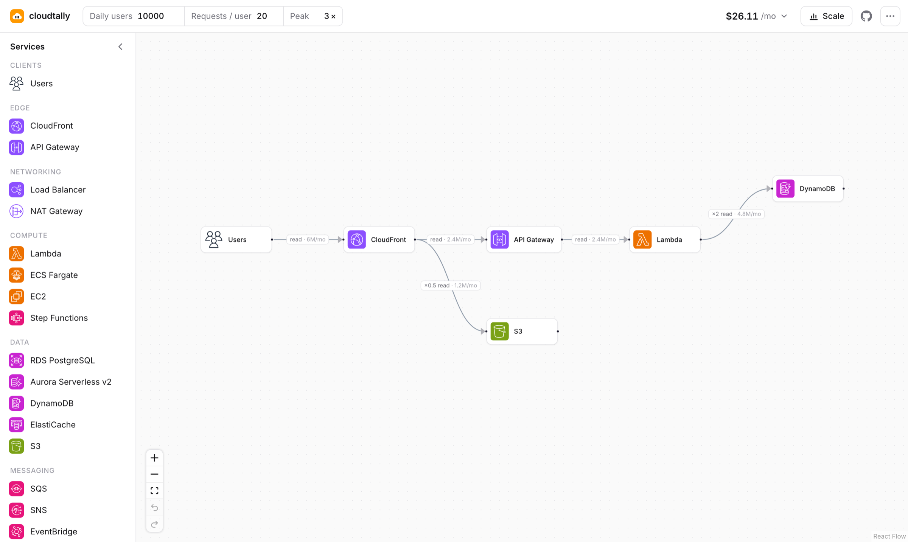

# cloudtally

**See what your AWS architecture costs while you draw it.**

[**Open cloudtally →**](https://cloudtally-one.vercel.app)

## Why

Architecture diagrams show what talks to what, but almost never what it costs. You find out after launch, when the bill arrives with a NAT Gateway line nobody planned for.

cloudtally is a diagram tool where cost is part of the design. Set how much traffic you expect, draw your services, and the monthly bill updates as you go, down to each service and each connection.

## What you can do

- **Price a design as you draw it.** 18 AWS services, an LLM API, and a custom service for anything else, each with the settings that change its price.
- **Model traffic, not just boxes.** Traffic starts at your users and flows along each connection. Set how many calls each request makes, such as 1 API call → 2 database reads.
- **See hidden costs.** Connections charge for internet egress and cross-AZ transfer, where surprise bills usually come from.
- **Plan for scale.** The Scale view charts cost from 1k to 10M daily users, so you can see which services stay flat, which grow, and where options like Lambda and Fargate cross over.
- **Share it.** Copy a link that opens your exact design, or export a PNG with the cost breakdown included.
- **Start fast.** Templates for a serverless API, a three-tier web app, an event pipeline and a static website.

## How to use it

1. **Set your traffic** in the header: daily users, requests per user and the peak-to-average ratio.
2. **Drag services** from the sidebar onto the canvas.
3. **Connect them** by dragging from the dot on the right of one service to another.
4. **Click anything** to configure it: memory, instance size, cache hit ratio, calls per request, payload size.
5. **Watch the total** in the header. Click it for a breakdown, or open **Scale** to see how it grows.

Everything saves in your browser automatically. Use the **⋯** menu to share a link, export a PNG, or save and open JSON files.

### Keyboard shortcuts

| Action | Shortcut |
|---|---|
| Undo / redo | ⌘Z / ⇧⌘Z |
| Copy, cut, paste | ⌘C, ⌘X, ⌘V |
| Duplicate | ⌘D |
| Select all | ⌘A |
| Delete selection | ⌫ |
| Select an area | Drag on the canvas |
| Pan | Scroll, or Space + drag |

Use Ctrl instead of ⌘ on Windows and Linux.

## How costs are calculated

1. **Traffic.** Monthly requests = daily users × requests per user × 30. Traffic starts at the **Users** node.
2. **Flow.** Each connection sends *calls per request × incoming requests* to the next service. CloudFront passes on only cache misses.
3. **Pricing.** Each service turns the traffic it receives into billable units, such as requests, GB-seconds or instance-hours, and prices them.
4. **Data transfer.** Connections add internet egress ($0.09/GB) and cross-AZ traffic ($0.02/GB). CloudFront prices its own egress.
5. **Peaks.** Average traffic × the peak multiplier sizes services that scale out, like Fargate.

Hover over any cost line in the side panel to see the quantity and unit price behind it.

## Services

| Group | Services |
|---|---|
| Edge | CloudFront, API Gateway (HTTP and REST) |
| Networking | Application Load Balancer, NAT Gateway |
| Compute | Lambda, ECS Fargate, EC2, Step Functions |
| Data | RDS PostgreSQL, Aurora Serverless v2, DynamoDB, ElastiCache, S3 |
| Messaging | SQS, SNS, EventBridge, Kinesis Data Streams |
| Security | Cognito |
| AI | LLM API (enter your model's per-token prices) |
| Other | Custom service (fixed monthly + per-request price) |

Missing one you need? [Request a service](https://github.com/Cyrus-Krispin/cloudtally/issues/new/choose).

## Pricing data

Prices are **us-east-1 on-demand list prices** from the public [AWS Price List API](https://docs.aws.amazon.com/awsaccountbilling/latest/aboutv2/using-the-aws-price-list-bulk-api.html), using the first pricing tier. A GitHub Action checks them every week and opens a pull request when any price changes.

cloudtally is for comparing designs and catching expensive surprises early. It isn't a quote: free tiers, savings plans, reserved pricing and volume discounts aren't included. Check the [AWS Pricing Calculator](https://calculator.aws/) before you commit to a budget.

## Contributing

Contributions are welcome, from new services and pricing fixes to design ideas. See [CONTRIBUTING.md](CONTRIBUTING.md) for how the project is set up and how to send a pull request.

## License

[MIT](LICENSE).

Service icons are the official [AWS Architecture Icons](https://aws.amazon.com/architecture/icons/), which AWS provides for architecture diagrams. They belong to AWS and aren't covered by this project's license. cloudtally isn't affiliated with Amazon Web Services.
